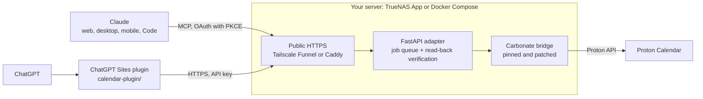

# proton-calendar-gpt

A self-hosted adapter that lets Claude and ChatGPT read and manage a Proton Calendar from natural language: "I have school tomorrow at 9:45", "move Friday's dentist to 14:00", "cancel next week's training".

It runs as a single Docker service on a home server, for example as a TrueNAS App, so it keeps working while your computer is off. Claude connects to it directly as a remote MCP connector. ChatGPT connects through a small plugin hosted on ChatGPT Sites. No OpenAI or Anthropic API key is needed.

> **Unofficial.** Not affiliated with or endorsed by Proton. The adapter talks to Proton through [Carbonate](https://github.com/develonrails/carbonate), a third-party bridge that uses Proton's private, unsupported API, so it can break without notice. Each deployment serves one person's Proton account; it is not a multi-user service.

## How it works



- **Adapter** (`app.py`, `calendar_operations.py`, `claude_connector.py`): a FastAPI service with a durable SQLite job queue. Every write is read back from Proton and compared before it is reported as `verified`.
- **Bridge**: Carbonate built from a pinned commit, plus a small patch (`carbonate-cli.patch`, `bridge-calendar-*.go`) that adds machine-readable calendar and event reads.
- **Claude connector**: a remote MCP endpoint at `/mcp` with single-owner OAuth.
- **ChatGPT plugin** (`calendar-plugin/`): MCP tools hosted on ChatGPT Sites that forward to the adapter with its API key.
- **Deployment**: self-contained TrueNAS Apps YAML files (`truenas/`) or plain Docker Compose files with Caddy or Tailscale Funnel for public HTTPS.

## Features

- List calendars, search events and list occurrences in a date range of up to 366 days.
- Create timed and all-day events; all-day end dates are exclusive.
- Edit, reschedule or delete an event after reading its current revision. Fields you don't mention, existing reminders and provider properties are preserved.
- Daily, weekly, monthly and yearly recurrence with intervals, counts, end dates and weekdays (all-day series use a count). Timed series keep their local start time across daylight-saving changes.
- Edit a whole series or a single occurrence, and cancel one occurrence without deleting the series.
- Add, replace, remove and read up to five device reminders per event.
- Duplicate protection: repeating an identical request returns the original job instead of creating a second event.

Out of scope: sending invitations, editing events with attendees (they are read-only), calendar sharing and creating email reminders.

## Security design

The adapter holds a live Proton session, so it is built to expose as little as possible:

- **Hardened container.** Runs as an unprivileged user (UID 10001) on a read-only root filesystem, with all Linux capabilities dropped, `no-new-privileges`, a size-limited `/tmp` and no Docker socket. The adapter's port is never published beyond localhost; only the chosen HTTPS front end is reachable from outside.
- **Authenticated API.** Every calendar operation needs the adapter's API key. Only `/healthz` and the API schema are public, and they contain no secrets or events.
- **Single-owner OAuth for Claude.** Dynamic client registration accepts only Claude's callback URLs and loopback redirects. PKCE is required. The approval page allows five wrong keys per 15 minutes. Access tokens last one hour; refresh tokens last 60 days and rotate on every use. Only token hashes are stored. Changing the API key revokes every connection.
- **Safe writes.** Mutations need the event's current revision, so stale edits are rejected. A write whose outcome is uncertain is reported as `unknown` and never retried automatically; it can be reconciled with a read-only check instead.
- **Prompt-injection guidance.** The assistant instructions treat event titles, descriptions and API responses as data, never as commands.
- **Credential handling.** The Proton password is only needed for the first login and should be removed from the configuration afterwards. Errors returned to the assistant are generic and never include Proton output or credentials.

Limits worth knowing: the Proton session is broader than a calendar-only token, and anyone with administrator access to the server or its backups can read decrypted calendar data.

## Status

Adapter 0.3.0. Tested in October 2026 against a real Proton account, directly through the adapter and through both assistants:

- Timed and all-day creation, rescheduling and deletion, for single events and whole series.
- Weekly recurrence across the October daylight-saving change, single-occurrence edits and cancellations.
- Device reminders on series and their exceptions, including delivery of a notification to an Android phone.
- Duplicate protection, and the Proton session surviving App rebuilds.
- ChatGPT: listing calendars, searching and reading events, and creating and editing a recurring series.
- Claude on claude.ai: OAuth discovery and approval, then creating, finding and deleting an event.

One ChatGPT check is still open: a final edit and cleanup request returned no result from the ChatGPT host. See [ACCEPTANCE.md](ACCEPTANCE.md) for the full checklist and findings, and [ROADMAP.md](ROADMAP.md) for the completion target.

## Setup

You need a server that runs Docker, a way to give it a public HTTPS address, and a Proton account. Run exactly one adapter per Proton session.

### Option A: TrueNAS App (recommended)

Follow [the TrueNAS Apps YAML guide](truenas/README.md). Each YAML file embeds the image build, storage setup and login, so the normal installation needs no SSH or prepared files:

- [Tailscale Funnel](truenas/funnel.yaml): no router port forwarding.
- [DDNS with Caddy](truenas/ddns.yaml): forward ports 80 and 443 to the server.
- [Existing reverse proxy](truenas/existing-proxy.yaml): bring your own proxy.

### Option B: Docker Compose

Do not run this alongside the TrueNAS App.

**1. Prepare.** Copy this repository into a dedicated directory or dataset, for example `/mnt/POOL/apps/proton-calendar-gpt`, then run:

```sh
cd /mnt/POOL/apps/proton-calendar-gpt
sudo python3 setup.py
sudo docker compose build
```

`setup.py` uses only Python's standard library and never overwrites existing files. It creates `data/` and `secrets/` (mode 700, owned by UID/GID 10001), a random adapter API key in `secrets/action_api_key`, an empty `secrets/bridge_password` and a `.env` file. Never put these on a shared, world-readable dataset. Builds use pinned Carbonate and Python package versions.

**2. Log in to Proton.** Before starting the web adapter, run:

```sh
sudo docker compose run --rm --no-deps calendar carbonate auth YOUR_PROTON_USERNAME -session /data/auth.json
```

Enter your Proton password and second factor in this terminal, never in a chat. Proton may ask for human verification. The bridge prints a new bridge password once: store it in your password manager and replace the empty `secrets/bridge_password` with it, keeping owner 10001:10001 and mode 600. It is different from both your Proton password and the adapter API key.

If your account has more than one calendar, list them and set `PROTON_CALENDAR_ID` in `.env`. Without it, the bridge refuses writes to multi-calendar accounts.

```sh
sudo docker compose run --rm --no-deps calendar carbonate calendars -session /data/auth.json
```

**3. Choose one public HTTPS connection.** The ChatGPT plugin and Claude call the adapter from the cloud, so it needs public HTTPS on port 443 with a valid certificate. A private Tailscale address won't work.

*DDNS with Caddy.* Set the hostname in `.env`:

```dotenv
PUBLIC_URL=https://your-ddns-host.example
CALENDAR_DOMAIN=your-ddns-host.example
```

The hostname must resolve to your public IP. Check that your ISP allows inbound connections and that you are not behind carrier-grade NAT; if an AAAA record exists, IPv6 must work too. Forward router TCP 80 to server port 10080 and 443 to 10443. Caddy obtains and renews a Let's Encrypt certificate automatically, and its configuration maps only this service.

```sh
sudo docker compose -f compose.yaml -f compose.ddns.yaml up -d
```

*Existing reverse proxy.* Proxy the hostname to the calendar container's port 8000 over its Docker network, or to `127.0.0.1:8787` from a proxy on the host, then run `sudo docker compose up -d`. Keep the server's management interface on a separate route.

*Tailscale Funnel.* This creates a separate Tailscale node called `proton-calendar`, so your server's existing node is never exposed. Put a non-ephemeral auth key in `secrets/tailscale.env` as `TS_AUTHKEY=...` (root-owned, mode 600) and enable MagicDNS, HTTPS certificates and Funnel for the node in your tailnet policy.

```sh
sudo docker compose -f compose.funnel.yaml up -d tailscale
sudo docker compose -f compose.funnel.yaml exec tailscale tailscale status
```

Set `PUBLIC_URL=https://proton-calendar.YOUR_TAILNET.ts.net` in `.env` using the hostname Tailscale assigned, then:

```sh
sudo docker compose -f compose.funnel.yaml up -d calendar
sudo docker compose -f compose.funnel.yaml exec tailscale tailscale funnel status
```

Check public access from a phone with Tailscale switched off, keep the Tailscale state volume persistent and review the node's key expiry.

## Connect Claude

The adapter serves a remote MCP connector at `https://YOUR_PUBLIC_HOST/mcp`. `PUBLIC_URL` must be that exact origin, because the OAuth metadata is built from it.

1. Check that `https://YOUR_PUBLIC_HOST/healthz` works from outside your network.
2. In claude.ai, open **Settings → Connectors → Add custom connector**, give it a name such as `My Proton Calendar` and enter the `/mcp` URL. Leave the advanced OAuth fields empty.
3. Claude opens an approval page served by your adapter. Paste `ACTION_API_KEY` and choose **Approve**. Only approve a connection you started yourself just now.
4. Connectors added on claude.ai also appear in the Claude mobile app, and Claude Desktop uses the same flow. Enable it in a chat and ask it to run `getIntegrationStatus`, then `getCalendarContext`.

For Claude Code: `claude mcp add --transport http proton-calendar https://YOUR_PUBLIC_HOST/mcp`, then authenticate from `/mcp`. To allow other redirect URIs, list them comma-separated in `OAUTH_EXTRA_REDIRECT_URIS`. The API key also works directly as a bearer token on `/mcp`.

## Connect ChatGPT

ChatGPT uses the plugin in [`calendar-plugin/`](calendar-plugin/README.md), deployed as your own private ChatGPT Sites project:

1. Set `PROTON_ADAPTER_URL` in the Site's runtime settings to the adapter's public HTTPS origin.
2. Set `PROTON_ACTION_API_KEY` as a **secret** with the value of `ACTION_API_KEY`. Enter it only in the secure settings, never in chat or source code.
3. Redeploy the Site's saved version so the settings take effect.
4. Connect the generated plugin in ChatGPT and ask it to check the calendar connection.

Keep both the Site and the plugin private, because they act on your Proton account. If ChatGPT keeps showing an old tool list after an upgrade, disconnect and reconnect the plugin, then start a new chat. Rebuilding the adapter alone does not refresh ChatGPT's tool list.

An older [custom GPT with Actions](custom-gpt-alternative.md) is kept as an optional alternative.

## Verify before everyday use

1. Run `getIntegrationStatus`, then `getCalendarContext`. They should report a reachable adapter, a configured Proton login, your timezone and the correct local time.
2. Create a disposable test event with an explicit date and time.
3. Wait for its status to reach `verified`, check it in the official Proton Calendar app, then delete it.
4. Try "I have school tomorrow at 9:45". The default duration is 60 minutes (`DEFAULT_DURATION_MINUTES`), so the event should end at 10:45.
5. Repeat the same request: it should return the same job rather than create a duplicate. Also try a date on the other side of a daylight-saving change.

## How writes are tracked

Requests are queued and answered immediately; one background worker keeps working after the chat turn ends. Poll `getCalendarOperationStatus` (or `getEventStatus` for the custom GPT) with the returned ID:

| State | Meaning |
| --- | --- |
| `pending`, `writing` | Still in progress. |
| `ready` / `verified` | Done, and the result was read back from Proton. For edits and deletes, only `result.verified: true` confirms the change. |
| `failed` | Failed before anything was written. |
| `unknown` | The write may or may not have happened. Check with `verifyEventWrite` or in Proton before trying again. |

Before editing, call `getCalendarEvent` to get the UID, calendar ID and current revision. Specify `event`, `series` or `occurrence` scope explicitly. Rescheduling a series that already has edited occurrences needs a manual check in Proton.

Identical requests reuse their job permanently, even after a restart. If you delete a verified event by hand, repeating the same request reports the original job and does not recreate it. Never delete the database just to retry an uncertain write without checking the calendar first.

## Maintenance

- **Log in again:** stop the adapter, run `carbonate auth ... -keep-bridge-password` with the same session path to keep your bridge password, then start it again.
- **Troubleshooting:** check the container logs for configuration errors. `carbonate calendars -session /data/auth.json` tests the Proton login, but prints your calendar names.
- **Removal:** stop the App or Compose stack, disconnect the plugin or connector, revoke the bridge's session in Proton, and remove the Funnel or proxy route. Deleting the containers does not delete `data/` or `secrets/`; keep or securely erase them according to your backup policy.

## Development

```sh
python3 -m venv .venv
.venv/bin/pip install -r requirements-dev.txt
.venv/bin/python -m pytest -q
```

The Python tests use a fake bridge and cover authorisation, the OAuth and MCP flow, input validation, UTC and timezone handling, iCalendar escaping, recurrence, duplicate prevention, queue limits, uncertain writes and read-back verification. `tests/recurrence_wire_test.go` tests the bridge patch, and the plugin has its own Node tests (see [`calendar-plugin/README.md`](calendar-plugin/README.md)). None of these prove that Carbonate can log in to a real account; [ACCEPTANCE.md](ACCEPTANCE.md) covers the live checks.

After changing the adapter source, Dockerfile, CLI patch or routing configuration, regenerate the TrueNAS YAML files with `python3 truenas/generate-yaml.py`.

## Licence

The original source is released under the [MIT License](LICENSE). Carbonate, the Python dependencies and parts of `calendar-plugin/` have their own licences, and some ChatGPT Sites tooling files carry no licence; see [THIRD_PARTY.md](THIRD_PARTY.md).

## References

- [Carbonate source and limitations](https://github.com/develonrails/carbonate)
- [ChatGPT plugins and mobile support](https://learn.chatgpt.com/docs/plugins)
- [MCP plugin authentication](https://developers.openai.com/plugins/build/auth)
- [GPT Actions](https://developers.openai.com/api/docs/actions/introduction)
- [Tailscale Funnel](https://tailscale.com/docs/features/tailscale-funnel)
- [Tailscale Docker configuration](https://tailscale.com/docs/features/containers/docker/docker-params)
- [TrueNAS custom Apps](https://www.truenas.com/docs/scale/apps/installcustomappscreens/)
- [Caddy automatic HTTPS](https://caddyserver.com/docs/automatic-https)
